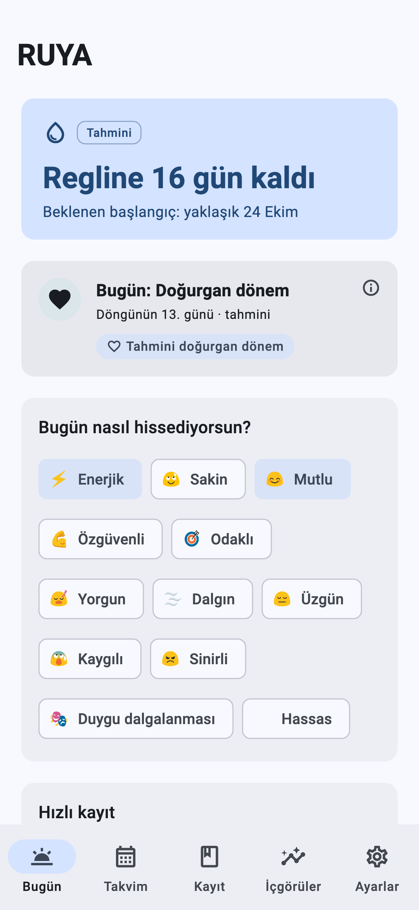
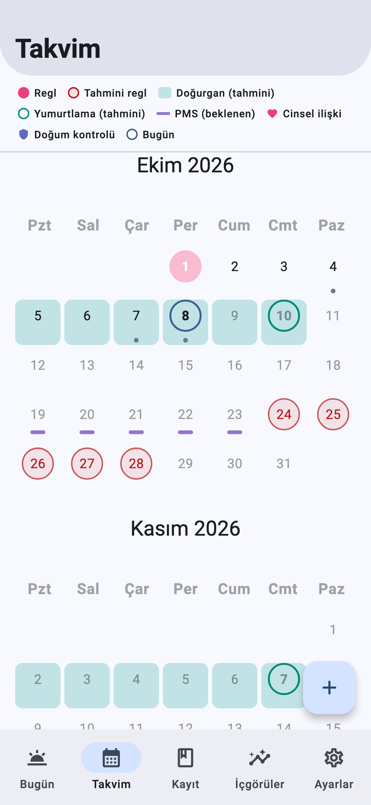
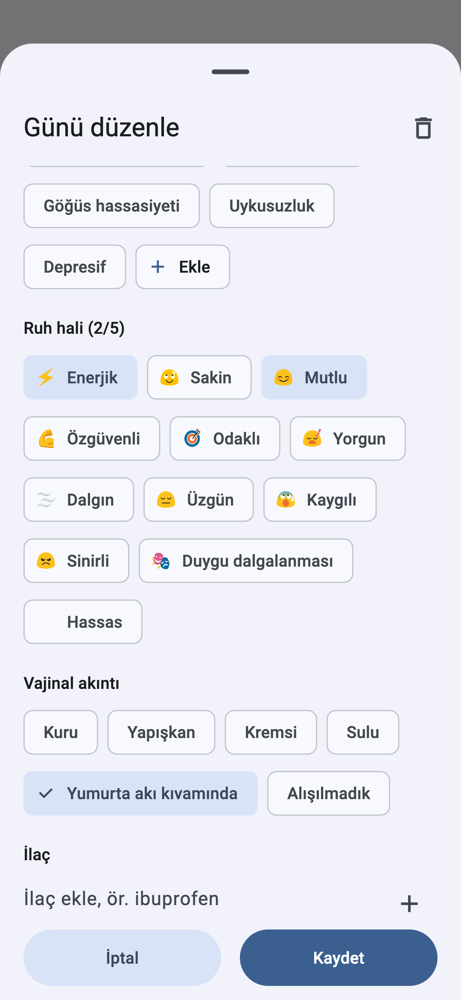
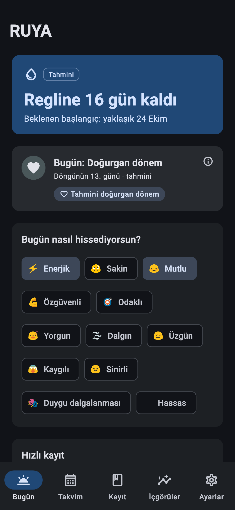
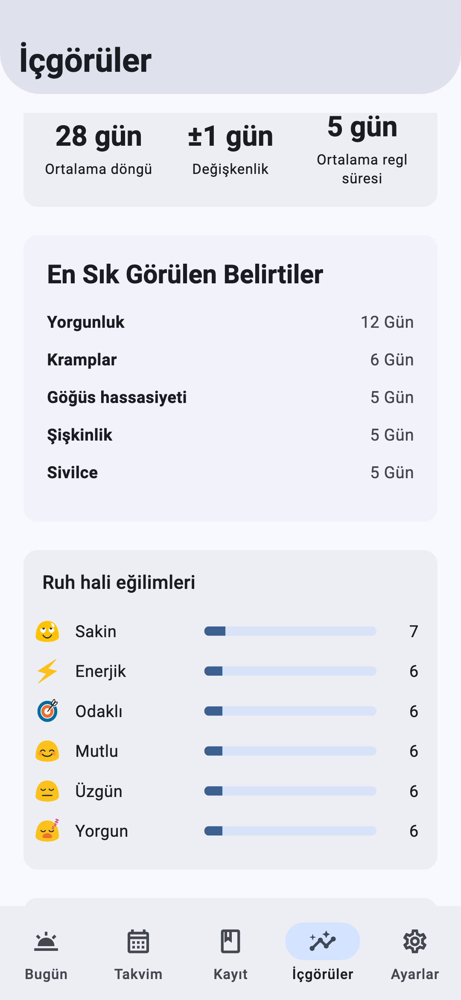
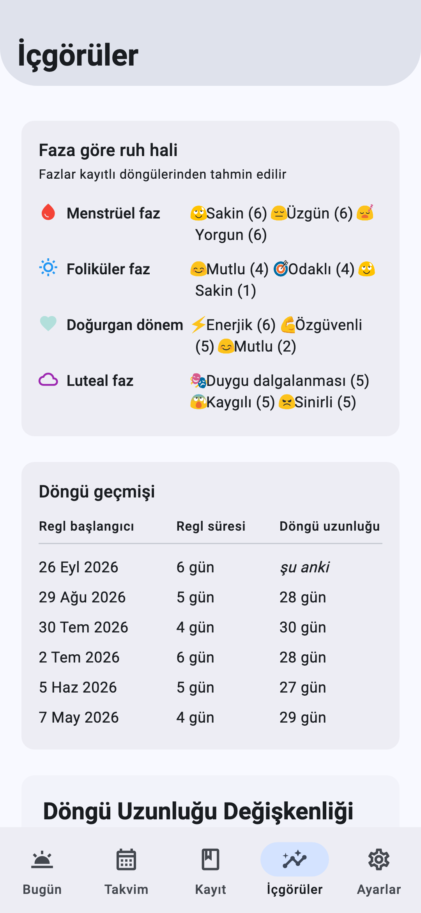
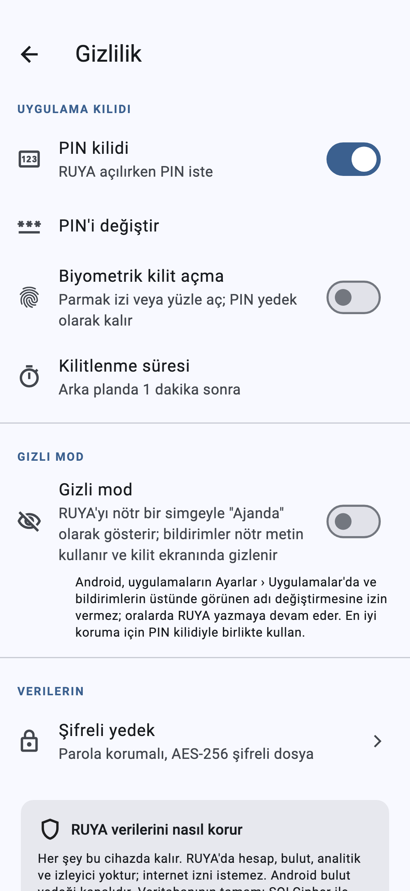
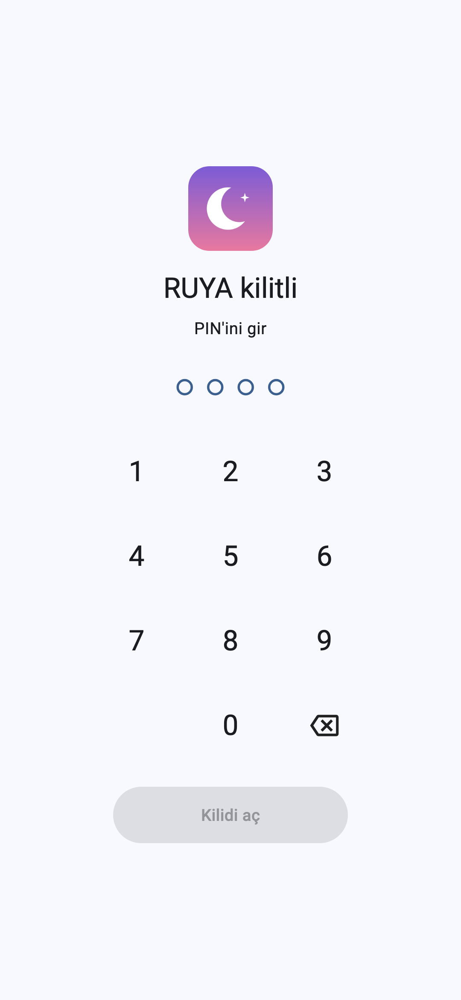

# ruya

**RUYA** — internet gerektirmeyen, cihaz üzerinde çalışan, gizlilik odaklı bir regl/döngü takip uygulaması (Android, Flutter).

* Bulut yok, hesap yok, analitik/izleyici yok. Release APK'da `INTERNET` izni yoktur.
* Veriler cihazdaki SQLCipher ile şifrelenmiş veritabanında; serbest metin alanları (not, ilaç) ayrıca AES-256-GCM ile şifrelenir. Anahtarlar Android Keystore'da tutulur.
* PIN kilidi, biyometrik kilit, ayarlanabilir kilit zaman aşımı, parola korumalı şifreli yedek.
* Tahminler (regl, yumurtlama, doğurgan dönem, PMS) **yaklaşık** değerlerdir; tıbbi tavsiye değildir.

## Ekran görüntüleri
| Bugün | Takvim | Günlük kayıt | Karanlık tema |
|---|---|---|---|
|  |  |  |  |

| İçgörüler | Faza göre ruh hali | Gizlilik | PIN kilidi |
|---|---|---|---|
|  |  |  |  |

Görüntüler örnek verilerle üretilir; yenilemek için `app/` içinde `flutter test testing/readme_screenshots_test.dart`.

## Proje yapısı
| Dizin | İçerik |
|---|---|
| `app/` | Ana Flutter uygulaması (Android) |
| `wear_app/` | Wear OS hızlı kayıt uygulaması |
| `docs/` | Mimari ve analiz dokümanları ([RUYA_ARCHITECTURE.md](docs/RUYA_ARCHITECTURE.md)) |
| `tool/` | Yardımcı scriptler (ör. l10n anahtarı ekleme) |

## Derleme
```bash
cd app
flutter pub get
flutter test
flutter build apk --release
```
Yayın imzası `app/android/app/key.properties` dosyasından okunur (gitignore'lu; anahtar repo dışında tutulur).
Dosya yoksa release APK yerel deneme için debug anahtarıyla imzalanır.

```bash
flutter build apk --release --split-per-abi
```
ABI'ye özel küçük APK'lar üretir (arm64-v8a ≈ 30 MB).

## Lisans ve atıf
RUYA, [J-shw/Menstrudel](https://github.com/J-shw/Menstrudel) projesinin bir çatallamasıdır ve **GPL-3.0** ile lisanslanmıştır (bkz. `LICENSE`).
Bazı özellik davranışları [Mooneva Cycle](https://github.com/aradar46/Mooneva-Cycle-Private-Period-Tracker) (GPL-3.0) referans alınarak Dart'ta yeniden yazılmıştır; kod kopyalanmamıştır.
Upstream README: [UPSTREAM_MENSTRUDEL_README.md](UPSTREAM_MENSTRUDEL_README.md).
